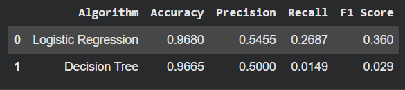
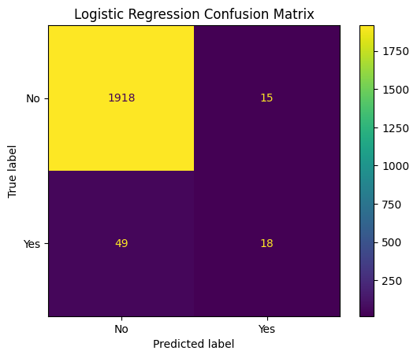
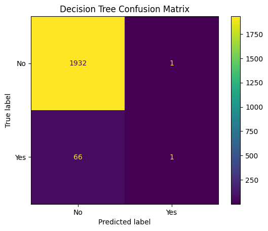
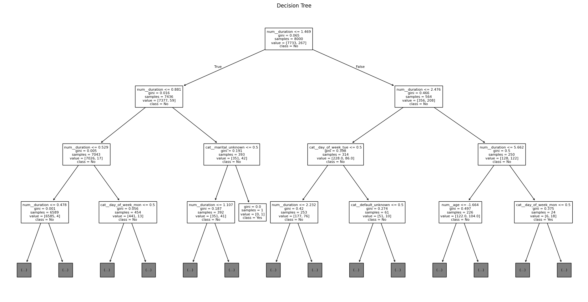

# 🏦 Bank Marketing Campaign Prediction

Machine learning project predicting whether a bank customer will subscribe to a term deposit, comparing **Logistic Regression** and **Decision Tree** models, and showing why accuracy alone can mislead on imbalanced data.

## 📌 Project Overview

Completed for **Unit 25: Machine Learning** (Pearson BTEC HND in Computing). The goal was to predict the target variable `y` (term-deposit subscription: yes/no) from customer demographics, employment details, previous campaign outcomes, and economic indicators.

## 📊 Dataset

- **10,000 customers**, 21 columns, no missing values
- **Target:** 9,666 "no" (96.66%) and 334 "yes" (3.34%), a strong **class imbalance**
- Source: the Bank Data Set supplied with the course (not included in this repository)

## 🔄 Methodology

1. Inspected structure, data types, and missing values
2. Encoded categorical variables with **One-Hot Encoding** and scaled numeric variables with **StandardScaler**
3. Built a **Pipeline with ColumnTransformer** so preprocessing is applied consistently and avoids data leakage
4. Split the data **80% training (8,000) / 20% testing (2,000)**
5. Trained **Logistic Regression** and a **Decision Tree** (max depth 5)
6. Evaluated with accuracy, precision, recall, F1-score, and confusion matrices

## 📈 Results

## 💡 Key Insights

- **Accuracy is misleading here.** A model that always predicts "no" would score **96.66%**, and the Decision Tree's 96.65% is no better than that.
- **Recall tells the real story.** The test set had **67 real subscribers**: Logistic Regression found **18**, the Decision Tree found only **1**.
- **Logistic Regression is better but not production-ready.** It misses about 73% of subscribers, so it needs further improvement before guiding a real marketing campaign.
- **The Decision Tree is easy to interpret** but needs tuning for imbalanced data.

## 🚀 Next Steps

- Apply **class weighting** or resampling to handle the imbalance
- Tune the decision threshold to trade precision against recall
- Compare more models (Random Forest, SVM) and report ROC-AUC
- Tune hyperparameters with cross-validation

## 📄 Documentation

- [Presentation: Machine Learning in Financial Analytics (pptx)](ml-presentation.pptx)
- [Project report extract: methodology and results (docx)](ml-report-extract.docx)

## 📂 Repository Contents

| File | Description |
|---|---|
| `bank_marketing_prediction.ipynb` | Full notebook (Bank_Data_Testing_Algorithm_Afry_Nizam) |
| `charts/` | Exported charts used in this README |

## 👤 Author

**Afry Nizam**: BSc Information Technology student, University of West London
[LinkedIn](https://www.linkedin.com/in/afrynizam) · [GitHub](https://github.com/afrynizam07)
